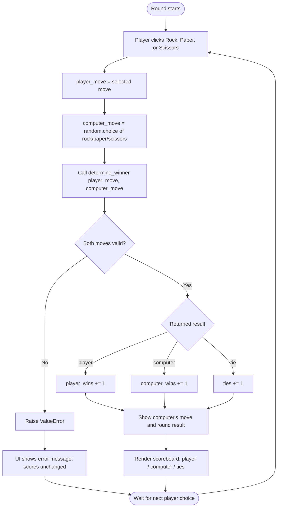
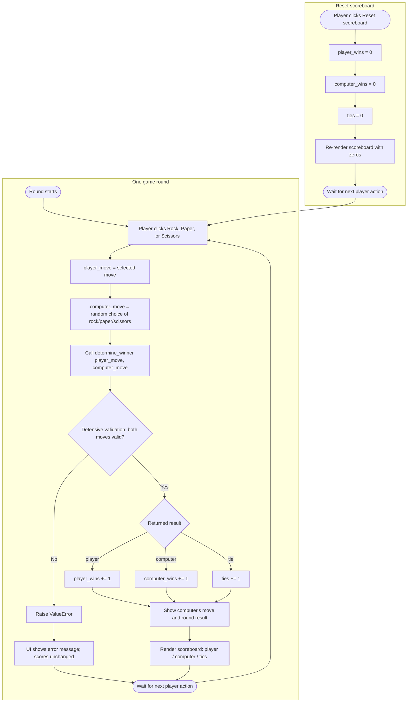

# Rock Paper Scissors design: Streamlit + TDD

**Session ID:** ses_e5248c22affes0VYdrcj3eMfEH
**Created:** 5/11/2026, 15:57:09
**Updated:** 5/11/2026, 16:14:50

---

## User

We're going to build a Rock, Paper, Scissors game in Python, using
Streamlit for the UI. Requirements:

1. The player picks rock, paper, or scissors; the computer picks randomly;
   the app shows the computer's move and the round result.
2. A scoreboard showing player wins, computer wins, and ties.
3. A function determine_winner(player_move: str, computer_move: str) -> str
   that returns "player", "computer", or "tie", and raises a ValueError if
   either move is invalid. It will be developed using TDD.

IMPORTANT: Do NOT write any code yet. First, give me only the design:
- A proposed file structure
- A flowchart in Mermaid syntax covering one full round of the game
  (user choice, computer choice, winner determination, scoreboard update)

Wait for my explicit approval before writing any code. 

---

## Assistant (Plan · Big Pickle · 6.8s)

_Thinking:_

The user wants design only, no code. Let me check if the directory has anything relevant first. Working directory is PPT. Maybe empty. A quick read of directory to inform file structure. Plan mode read-only is fine.

Let me list files.

**Tool: bash**

**Input:**
```json
{
  "command": "Get-ChildItem -Force | Select-Object Name, Mode, Length"
}
```

**Output:**
```
(no output)
```

---

## Assistant (Plan · Big Pickle · 12.8s)

_Thinking:_

Empty directory. Now present design: file structure, Mermaid flowchart. No code. Since it's TDD, file structure includes game_logic.py, app.py, tests/test_game_logic.py, requirements.txt, README maybe. Keep concise but complete. Also mention design decisions briefly: ValueError validation, session state for scoreboard, function returns "player"/"computer"/"tie".

Flowchart Mermaid covering one full round. Should include validation? User choice, computer random, determine winner, scoreboard update. Include decision nodes.

I should present plan and wait approval. Maybe the instruction says concise but this is a design deliverable. Use markdown.

Proposed file structure:

PPT/
├── app.py
├── game_logic.py
├── requirements.txt
├── tests/
│   ├── __init__.py
│   └── test_game_logic.py
└── README.md

Maybe pytest config not needed. Requirements streamlit, pytest.

Design of determine_winner: constants MOVES, BEATS mapping. Note ValueError for invalid moves, case sensitivity — decide: exact lowercase only; validate type str. Tests TDD: invalid input, all nine combos, symmetry, ValueError messages.

Session state keys: player_wins, computer_wins, ties, last_computer_move maybe. Scoreboard persists across reruns via st.session_state.

Flowchart:

flowchart TD
  A[Start round] --> B[Player clicks Rock/Paper/Scissors]
  B --> C[player_move = chosen move]
  C --> D[computer_move = random choice from MOVES]
  D --> E[result = determine_winner(player_move, computer_move)]
  E --> F{Valid moves?}
  F -- No --> G[Raise ValueError] --> H[UI shows error; no score change]
  F -- Yes --> I{result}
  I -- player --> J[player_wins += 1]
  I -- computer --> K[computer_wins += 1]
  I -- tie --> L[ties += 1]
  J --> M[Display computer move, round result, scoreboard]
  K --> M
  L --> M
  M --> N[Wait for next click]
  N --> B

Node E before validation is weird; determine_winner includes validation. Make validation part of function. Flowchart: computer choice -> call determine_winner -> decision valid? Actually decision is inside function. Could show decision "Valid moves?" before result. Better:

B --> C --> D --> E[Call determine_winner] --> F{Both moves valid?}
F -- No --> G[Raise ValueError -> show error, scores unchanged]
F -- Yes --> H{result}
...

Then update scoreboard and render.

Also mention UI layout: title, three buttons columns, result display, metrics for scoreboard, reset button optional. But user asked only design: file structure and flowchart. We can include a short "Behavioral contract" for determine_winner and state. Don't overdo. Wait approval.

## Proposed file structure

```
PPT/
├── app.py                    # Streamlit UI: layout, buttons, session state, scoreboard
├── game_logic.py             # Pure game logic (no Streamlit imports)
├── requirements.txt          # streamlit, pytest
├── README.md                 # Setup and run instructions
└── tests/
    ├── __init__.py
    └── test_game_logic.py    # TDD tests for determine_winner()
```

Design rationale:
- `game_logic.py` is framework-agnostic so it can be tested in isolation with pytest (TDD first), keeping Streamlit concerns out.
- `app.py` imports `determine_winner` and manages UI + scoreboard state.
- Scoreboard counters live in `st.session_state` (`player_wins`, `computer_wins`, `ties`) so they survive Streamlit reruns.

### Contract for `determine_winner`

- Valid moves: `"rock"`, `"paper"`, `"scissors"` (lowercase, exact).
- Returns: `"player"`, `"computer"`, or `"tie"`.
- Raises `ValueError` if either argument is not a valid move (including non-strings/`None`).
- Tests written first cover: all 9 move combinations, both win directions, ties, and invalid input for each argument.

## Flowchart (one round)



Awaiting your explicit approval before writing any code.

---

## User

I approve the design. You may proceed now, but we will follow strict TDD.
Step 1: write ONLY tests/test_game_logic.py for determine_winner using
pytest. Cover: all 3 player-win cases, all 3 computer-win cases, all 3 tie
cases, and invalid inputs (invalid player move, invalid computer move,
empty string, wrong casing, None) that must raise ValueError. Also create
game_logic.py with a stub of determine_winner that only raises
NotImplementedError, so the tests fail properly. Add a pytest.ini with
pythonpath = . so imports work. Do NOT implement the real logic yet and
do NOT create app.py yet. Please update the flowchart to also show the "Reset scoreboard" button as
a separate flow that sets player_wins, computer_wins and ties back to 0.
Also label the invalid-move check as defensive validation. Still no code,
just the updated Mermaid diagram. 

---

## Assistant (Plan · Big Pickle · 18.6s)

_Thinking:_

We're in plan mode, read-only. User says proceed with TDD step 1, but system reminder says no edits. Also says "Still no code, just the updated Mermaid diagram." Contradiction: they say write tests files but also no code, just diagram. The system reminder overrides. So I should present the plan: what tests will be written, stub, pytest.ini, and updated flowchart including reset scoreboard and defensive validation. No files edited.

I should inspect current dir (empty) — already know. Provide test plan with exact test cases, file contents plan perhaps not actual code? They asked "Still no code, just the updated Mermaid diagram." So main deliverable is updated diagram and plan. I can describe test cases in a list, no code.

Need updated flowchart: one round flow plus reset scoreboard separate flow. Label invalid-move check "defensive validation". Include reset button separate flow setting counters to 0. Maybe two flowcharts or subgraphs. "update the flowchart" — can do single Mermaid with subgraphs: Round flow and Reset flow. Ensure reset re-renders scoreboard and waits for next choice.

Note: since in plan mode, mention I haven't created files and await exiting plan mode. But user approved design and asked proceed. Plan mode still active, so final message should present plan and ask to switch to build mode. Keep concise-ish.

Flowchart:

flowchart TD
 subgraph ROUND[One game round]
 A([Round starts]) --> B[Player clicks Rock / Paper / Scissors]
 B --> C[player_move = selected move]
 C --> D[computer_move = random.choice MOVES]
 D --> E[determine_winner player_move, computer_move]
 E --> F{Defensive validation: both moves valid?}
 F -- No --> G[Raise ValueError]
 G --> H[UI shows error; scores unchanged]
 H --> Z([Wait for next action])
 F -- Yes --> I{Result}
 I -- player --> J[player_wins += 1]
 I -- computer --> K[computer_wins += 1]
 I -- tie --> L[ties += 1]
 J --> M[...]
 K --> M
 L --> M
 M --> N[Render scoreboard player/computer/ties]
 N --> Z
 end

 subgraph RESET[Reset scoreboard]
 R1([Player clicks Reset scoreboard]) --> R2[player_wins = 0]
 R2 --> R3[computer_wins = 0]
 R3 --> R4[ties = 0]
 R4 --> R5[Re-render scoreboard]
 R5 --> Z2([Wait for next action])
 end

 Z --> B
 Z2 --> B maybe both connect to player choice. Could link Z and Z2 to B. Fine.

Test plan list:
- 3 player wins: rock vs scissors, paper vs rock, scissors vs paper
- 3 computer wins: rock vs paper, paper vs scissors, scissors vs rock
- 3 ties: same move each
- invalid: player "lizard", computer "lizard", empty strings (player "", computer ""), wrong casing ("Rock", "PAPER", maybe both directions), None for player and computer. Parametrize.
- maybe non-string 1? User didn't ask but optional. Don't add extras beyond requirement? Could mention optional, but strict TDD says cover specified. Keep exactly.

Stub: determine_winner raises NotImplementedError. All tests fail. pytest.ini pythonpath = .

Also tests need import path, no __init__ maybe. File structure tests/test_game_logic.py and pytest.ini; the earlier structure had tests/__init__.py but not necessary with pythonpath. Could still create it? User said only tests/test_game_logic.py, game_logic.py stub, pytest.ini. Don't create __init__.py unless needed. With pytest rootdir and pythonpath=., importing game_logic works. tests file can `from game_logic import determine_winner`. No __init__.py needed. Mention no app.py yet.

Verification command: python -m pytest -q, expect 15 failures (or however many parametrized cases). Count: 3+3+3=9 plus invalid param sets: invalid player, invalid computer, empty string player, empty string computer, wrong casing player, wrong casing computer, None player, None computer = 8 → total 17. User listed invalid player move, invalid computer move, empty string, wrong casing, None. Could make 5 cases where empty/casing/None tested maybe for one arg each? Better to cover each argument. But count expectation flexible; parametrized 17 cases. Or group empty string tests as one param case with both? Each param case tests one invocation. Let's design 9 valid + 8 invalid = 17 tests.

Actually "empty string" could be a single test for player, but symmetry: include both. Fine.

TDD cycle after they exit plan mode:
1. Write tests + stub + pytest.ini
2. Run pytest, confirm all fail with NotImplementedError (red)
3. Stop; don't implement until next approval.

Should I ask them to toggle plan mode? Say "Plan mode is still active, so no files have been created. Approve/exit plan mode and I'll write the three files and run pytest to confirm red." Concise.

Given "Still no code, just the updated Mermaid diagram" I shouldn't include code. Listing test names okay. Maybe include a table of test IDs. Fine.

Let me draft.

Plan mode is still active, so nothing has been written. Here is the Step 1 execution plan plus the updated diagram.

## Step 1 plan (to run once plan mode is exited)

Files to create, nothing else:

| File | Content |
|---|---|
| `game_logic.py` | Only `def determine_winner(player_move: str, computer_move: str) -> str:` raising `NotImplementedError` |
| `tests/test_game_logic.py` | Pytest tests only (no implementation) |
| `pytest.ini` | `[pytest]` with `pythonpath = .` |

Test cases to write (17 total, parametrized):

- Player wins (3): rock/scissors, paper/rock, scissors/paper
- Computer wins (3): rock/paper, paper/scissors, scissors/rock
- Ties (3): rock/rock, paper/paper, scissors/scissors
- `ValueError` (8): invalid player move, invalid computer move, empty player string, empty computer string, wrong casing on player (`"Rock"`), wrong casing on computer (`"PAPER"`), `None` as player, `None` as computer

Then run `python -m pytest -q` and confirm all 17 fail with `NotImplementedError` (red phase). Stop there — no real logic, no `app.py`.

## Updated flowchart



Exit plan mode when ready and I'll create the three files and run pytest to confirm the red phase.

---

## User

I approve the design. You may proceed now, but we will follow strict TDD.
Step 1: write ONLY the test file (test_game.py) for determine_winner using
pytest. Cover: all 3 player-win cases, all 3 computer-win cases, all 3 tie
cases, and invalid inputs (invalid player move, invalid computer move,
empty string, wrong casing if you decide it's invalid) that must raise
ValueError. Also create game.py with a stub of determine_winner that only
raises NotImplementedError, so the tests fail properly. Do NOT implement
the real logic yet. 

---

## Assistant (Build · Big Pickle · 17.0s)

_Thinking:_

Now build mode. User changed filenames: test_game.py and game.py, not earlier structure. Follow latest instructions. Strict TDD step 1.

Create game.py with stub determine_winner raising NotImplementedError. Create tests/test_game.py? They say "write ONLY the test file (test_game.py)". Could put at root test_game.py, or tests/test_game.py. Earlier structure had tests/. Latest says test_game.py. Ambiguous path. They mention "test file (test_game.py)" and "game.py". I'll use tests/test_game.py consistent with earlier approved structure? But they said ONLY test file (test_game.py) and game.py. Hmm. Earlier structure tests/test_game_logic.py. Now explicitly renames to test_game.py. Could place root test_game.py. pytest.ini with pythonpath = . would work in either. Need app imports game. Root files simplest: game.py, test_game.py, pytest.ini. But earlier design had tests/ folder. Latest instruction overrides naming, not necessarily location. "write ONLY the test file (test_game.py)" — if I create tests/test_game.py, that's still test_game.py. But "ONLY" maybe means only test file, no pytest.ini mention this time. Earlier they asked pytest.ini pythonpath=.; still needed if tests/ folder. If root, pythonpath=. still helpful but pytest adds rootdir? Running pytest from root adds rootdir to sys.path? With rootdir insertion, test file in root can import game. On Windows, pythonpath = . ensures.

I'll use `tests/test_game.py` and keep `pytest.ini`? User said create game.py and test file, and previously asked pytest.ini. This time they didn't ask pytest.ini, but said write ONLY the test file and game.py stub. To respect "ONLY", don't create pytest.ini? But then imports if tests folder fail unless pytest rootdir inserts. Pytest with rootdir and no __init__.py inserts test file's dirname (tests) into sys.path, not root, so `from game import` fails. Could avoid by placing test_game.py in root. Then only two files, no pytest.ini. That best matches "ONLY the test file (test_game.py)" and "game.py". Root test_game.py imports game directly. Run `python -m pytest -q`, and `python -m` adds cwd to sys.path. Good.

Should I keep pytest.ini from earlier? It wasn't created. User says only test file and game.py. So no pytest.ini. Place test at root. Good.

Tests: 9 valid + invalid inputs. Include invalid player move, invalid computer move, empty string, wrong casing. Decide casing invalid (exact lowercase), as design stated. Also could None but not requested this time; earlier included None. Latest excludes None explicitly but says invalid inputs (...). Could include None as extra but strict "cover: ..." maybe fine. Keep to requested: invalid player move "lizard", invalid computer move "lizard", empty string for both, wrong casing for both. That's 8 invalid. Parametrize.

Use pytest.mark.parametrize with ids. Ensure tests fail due NotImplementedError, not import error. game.py stub signature. Write tests now using write tool. Check existing files first? Directory empty. We know. Write.

File contents:

game.py:
def determine_winner(player_move: str, computer_move: str) -> str:
    raise NotImplementedError("determine_winner is not implemented yet")

test_game.py:

import pytest
from game import determine_winner

PLAYER_WIN_CASES = [...]
...

@pytest.mark.parametrize("player_move, computer_move", [...], ids=[...])
def test_player_wins(player_move, computer_move):
    assert determine_winner(player_move, computer_move) == "player"

Similarly computer, tie.

Invalid:
INVALID_CASES maybe tuples with id.

@pytest.mark.parametrize("player_move, computer_move", [...])
def test_invalid_moves_raise_value_error(...):
    with pytest.raises(ValueError):
        determine_winner(player_move, computer_move)

Include invalid player "lizard" vs "rock"; invalid computer "rock" vs "lizard"; empty player "" vs "rock"; empty computer "rock" vs ""; wrong casing player "Rock" vs "rock"; wrong casing computer "rock" vs "Rock"; maybe "PAPER". Add both? "wrong casing" singular. Use "Rock"/"rock" and "rock"/"Rock". Could add "ROCK". Keep simple.

Should tests include type hints? Not necessary.

Then run pytest -q expecting 15 failed (9+6). Count invalid: 6. Total 15. Confirm.

Need no comments per code style. Write files. Then run. Also maybe py_compile? pytest enough.

Let's do write calls in parallel? Two independent writes, can batch. But tool calls in same message. Then bash. We must wait for writes? They are independent. Do parallel writes, then run pytest sequentially after.

**Tool: write**

**Input:**
```json
{
  "filePath": "C:\\Users\\deban\\OneDrive\\Documentos\\PPT\\game.py",
  "content": "def determine_winner(player_move: str, computer_move: str) -> str:\n    raise NotImplementedError(\"determine_winner is not implemented yet\")\n"
}
```

**Output:**
```
Wrote file successfully.
```

**Tool: write**

**Input:**
```json
{
  "filePath": "C:\\Users\\deban\\OneDrive\\Documentos\\PPT\\test_game.py",
  "content": "import pytest\n\nfrom game import determine_winner\n\n\n@pytest.mark.parametrize(\n    \"player_move, computer_move\",\n    [\n        (\"rock\", \"scissors\"),\n        (\"paper\", \"rock\"),\n        (\"scissors\", \"paper\"),\n    ],\n    ids=[\"rock-beats-scissors\", \"paper-beats-rock\", \"scissors-beats-paper\"],\n)\ndef test_player_wins(player_move, computer_move):\n    assert determine_winner(player_move, computer_move) == \"player\"\n\n\n@pytest.mark.parametrize(\n    \"player_move, computer_move\",\n    [\n        (\"rock\", \"paper\"),\n        (\"paper\", \"scissors\"),\n        (\"scissors\", \"rock\"),\n    ],\n    ids=[\"rock-loses-to-paper\", \"paper-loses-to-scissors\", \"scissors-loses-to-rock\"],\n)\ndef test_computer_wins(player_move, computer_move):\n    assert determine_winner(player_move, computer_move) == \"computer\"\n\n\n@pytest.mark.parametrize(\n    \"player_move, computer_move\",\n    [\n        (\"rock\", \"rock\"),\n        (\"paper\", \"paper\"),\n        (\"scissors\", \"scissors\"),\n    ],\n    ids=[\"rock-ties\", \"paper-ties\", \"scissors-tie\"],\n)\ndef test_tie(player_move, computer_move):\n    assert determine_winner(player_move, computer_move) == \"tie\"\n\n\n@pytest.mark.parametrize(\n    \"player_move, computer_move\",\n    [\n        (\"lizard\", \"rock\"),\n        (\"rock\", \"lizard\"),\n        (\"\", \"rock\"),\n        (\"rock\", \"\"),\n        (\"Rock\", \"rock\"),\n        (\"rock\", \"Rock\"),\n    ],\n    ids=[\n        \"invalid-player-move\",\n        \"invalid-computer-move\",\n        \"empty-player-move\",\n        \"empty-computer-move\",\n        \"wrong-casing-player-move\",\n        \"wrong-casing-computer-move\",\n    ],\n)\ndef test_invalid_moves_raise_value_error(player_move, computer_move):\n    with pytest.raises(ValueError):\n        determine_winner(player_move, computer_move)\n"
}
```

**Output:**
```
Wrote file successfully.
```

---

## Assistant (Build · Big Pickle · 9.4s)

_Thinking:_

Run pytest.

**Tool: bash**

**Input:**
```json
{
  "command": "python -m pytest -q",
  "workdir": "C:\\Users\\deban\\OneDrive\\Documentos\\PPT"
}
```

**Output:**
```
FFFFFFFFFFFFFFF                                                          [100%]
================================== FAILURES ===================================
____________________ test_player_wins[rock-beats-scissors] ____________________

player_move = 'rock', computer_move = 'scissors'

    @pytest.mark.parametrize(
        "player_move, computer_move",
        [
            ("rock", "scissors"),
            ("paper", "rock"),
            ("scissors", "paper"),
        ],
        ids=["rock-beats-scissors", "paper-beats-rock", "scissors-beats-paper"],
    )
    def test_player_wins(player_move, computer_move):
>       assert determine_winner(player_move, computer_move) == "player"
               ^^^^^^^^^^^^^^^^^^^^^^^^^^^^^^^^^^^^^^^^^^^^

test_game.py:16: 
_ _ _ _ _ _ _ _ _ _ _ _ _ _ _ _ _ _ _ _ _ _ _ _ _ _ _ _ _ _ _ _ _ _ _ _ _ _ _ _

player_move = 'rock', computer_move = 'scissors'

    def determine_winner(player_move: str, computer_move: str) -> str:
>       raise NotImplementedError("determine_winner is not implemented yet")
E       NotImplementedError: determine_winner is not implemented yet

game.py:2: NotImplementedError
_____________________ test_player_wins[paper-beats-rock] ______________________

player_move = 'paper', computer_move = 'rock'

    @pytest.mark.parametrize(
        "player_move, computer_move",
        [
            ("rock", "scissors"),
            ("paper", "rock"),
            ("scissors", "paper"),
        ],
        ids=["rock-beats-scissors", "paper-beats-rock", "scissors-beats-paper"],
    )
    def test_player_wins(player_move, computer_move):
>       assert determine_winner(player_move, computer_move) == "player"
               ^^^^^^^^^^^^^^^^^^^^^^^^^^^^^^^^^^^^^^^^^^^^

test_game.py:16: 
_ _ _ _ _ _ _ _ _ _ _ _ _ _ _ _ _ _ _ _ _ _ _ _ _ _ _ _ _ _ _ _ _ _ _ _ _ _ _ _

player_move = 'paper', computer_move = 'rock'

    def determine_winner(player_move: str, computer_move: str) -> str:
>       raise NotImplementedError("determine_winner is not implemented yet")
E       NotImplementedError: determine_winner is not implemented yet

game.py:2: NotImplementedError
___________________ test_player_wins[scissors-beats-paper] ____________________

player_move = 'scissors', computer_move = 'paper'

    @pytest.mark.parametrize(
        "player_move, computer_move",
        [
            ("rock", "scissors"),
            ("paper", "rock"),
            ("scissors", "paper"),
        ],
        ids=["rock-beats-scissors", "paper-beats-rock", "scissors-beats-paper"],
    )
    def test_player_wins(player_move, computer_move):
>       assert determine_winner(player_move, computer_move) == "player"
               ^^^^^^^^^^^^^^^^^^^^^^^^^^^^^^^^^^^^^^^^^^^^

test_game.py:16: 
_ _ _ _ _ _ _ _ _ _ _ _ _ _ _ _ _ _ _ _ _ _ _ _ _ _ _ _ _ _ _ _ _ _ _ _ _ _ _ _

player_move = 'scissors', computer_move = 'paper'

    def determine_winner(player_move: str, computer_move: str) -> str:
>       raise NotImplementedError("determine_winner is not implemented yet")
E       NotImplementedError: determine_winner is not implemented yet

game.py:2: NotImplementedError
___________________ test_computer_wins[rock-loses-to-paper] ___________________

player_move = 'rock', computer_move = 'paper'

    @pytest.mark.parametrize(
        "player_move, computer_move",
        [
            ("rock", "paper"),
            ("paper", "scissors"),
            ("scissors", "rock"),
        ],
        ids=["rock-loses-to-paper", "paper-loses-to-scissors", "scissors-loses-to-rock"],
    )
    def test_computer_wins(player_move, computer_move):
>       assert determine_winner(player_move, computer_move) == "computer"
               ^^^^^^^^^^^^^^^^^^^^^^^^^^^^^^^^^^^^^^^^^^^^

test_game.py:29: 
_ _ _ _ _ _ _ _ _ _ _ _ _ _ _ _ _ _ _ _ _ _ _ _ _ _ _ _ _ _ _ _ _ _ _ _ _ _ _ _

player_move = 'rock', computer_move = 'paper'

    def determine_winner(player_move: str, computer_move: str) -> str:
>       raise NotImplementedError("determine_winner is not implemented yet")
E       NotImplementedError: determine_winner is not implemented yet

game.py:2: NotImplementedError
_________________ test_computer_wins[paper-loses-to-scissors] _________________

player_move = 'paper', computer_move = 'scissors'

    @pytest.mark.parametrize(
        "player_move, computer_move",
        [
            ("rock", "paper"),
            ("paper", "scissors"),
            ("scissors", "rock"),
        ],
        ids=["rock-loses-to-paper", "paper-loses-to-scissors", "scissors-loses-to-rock"],
    )
    def test_computer_wins(player_move, computer_move):
>       assert determine_winner(player_move, computer_move) == "computer"
               ^^^^^^^^^^^^^^^^^^^^^^^^^^^^^^^^^^^^^^^^^^^^

test_game.py:29: 
_ _ _ _ _ _ _ _ _ _ _ _ _ _ _ _ _ _ _ _ _ _ _ _ _ _ _ _ _ _ _ _ _ _ _ _ _ _ _ _

player_move = 'paper', computer_move = 'scissors'

    def determine_winner(player_move: str, computer_move: str) -> str:
>       raise NotImplementedError("determine_winner is not implemented yet")
E       NotImplementedError: determine_winner is not implemented yet

game.py:2: NotImplementedError
_________________ test_computer_wins[scissors-loses-to-rock] __________________

player_move = 'scissors', computer_move = 'rock'

    @pytest.mark.parametrize(
        "player_move, computer_move",
        [
            ("rock", "paper"),
            ("paper", "scissors"),
            ("scissors", "rock"),
        ],
        ids=["rock-loses-to-paper", "paper-loses-to-scissors", "scissors-loses-to-rock"],
    )
    def test_computer_wins(player_move, computer_move):
>       assert determine_winner(player_move, computer_move) == "computer"
               ^^^^^^^^^^^^^^^^^^^^^^^^^^^^^^^^^^^^^^^^^^^^

test_game.py:29: 
_ _ _ _ _ _ _ _ _ _ _ _ _ _ _ _ _ _ _ _ _ _ _ _ _ _ _ _ _ _ _ _ _ _ _ _ _ _ _ _

player_move = 'scissors', computer_move = 'rock'

    def determine_winner(player_move: str, computer_move: str) -> str:
>       raise NotImplementedError("determine_winner is not implemented yet")
E       NotImplementedError: determine_winner is not implemented yet

game.py:2: NotImplementedError
_____________________________ test_tie[rock-ties] _____________________________

player_move = 'rock', computer_move = 'rock'

    @pytest.mark.parametrize(
        "player_move, computer_move",
        [
            ("rock", "rock"),
            ("paper", "paper"),
            ("scissors", "scissors"),
        ],
        ids=["rock-ties", "paper-ties", "scissors-tie"],
    )
    def test_tie(player_move, computer_move):
>       assert determine_winner(player_move, computer_move) == "tie"
               ^^^^^^^^^^^^^^^^^^^^^^^^^^^^^^^^^^^^^^^^^^^^

test_game.py:42: 
_ _ _ _ _ _ _ _ _ _ _ _ _ _ _ _ _ _ _ _ _ _ _ _ _ _ _ _ _ _ _ _ _ _ _ _ _ _ _ _

player_move = 'rock', computer_move = 'rock'

    def determine_winner(player_move: str, computer_move: str) -> str:
>       raise NotImplementedError("determine_winner is not implemented yet")
E       NotImplementedError: determine_winner is not implemented yet

game.py:2: NotImplementedError
____________________________ test_tie[paper-ties] _____________________________

player_move = 'paper', computer_move = 'paper'

    @pytest.mark.parametrize(
        "player_move, computer_move",
        [
            ("rock", "rock"),
            ("paper", "paper"),
            ("scissors", "scissors"),
        ],
        ids=["rock-ties", "paper-ties", "scissors-tie"],
    )
    def test_tie(player_move, computer_move):
>       assert determine_winner(player_move, computer_move) == "tie"
               ^^^^^^^^^^^^^^^^^^^^^^^^^^^^^^^^^^^^^^^^^^^^

test_game.py:42: 
_ _ _ _ _ _ _ _ _ _ _ _ _ _ _ _ _ _ _ _ _ _ _ _ _ _ _ _ _ _ _ _ _ _ _ _ _ _ _ _

player_move = 'paper', computer_move = 'paper'

    def determine_winner(player_move: str, computer_move: str) -> str:
>       raise NotImplementedError("determine_winner is not implemented yet")
E       NotImplementedError: determine_winner is not implemented yet

game.py:2: NotImplementedError
___________________________ test_tie[scissors-tie] ____________________________

player_move = 'scissors', computer_move = 'scissors'

    @pytest.mark.parametrize(
        "player_move, computer_move",
        [
            ("rock", "rock"),
            ("paper", "paper"),
            ("scissors", "scissors"),
        ],
        ids=["rock-ties", "paper-ties", "scissors-tie"],
    )
    def test_tie(player_move, computer_move):
>       assert determine_winner(player_move, computer_move) == "tie"
               ^^^^^^^^^^^^^^^^^^^^^^^^^^^^^^^^^^^^^^^^^^^^

test_game.py:42: 
_ _ _ _ _ _ _ _ _ _ _ _ _ _ _ _ _ _ _ _ _ _ _ _ _ _ _ _ _ _ _ _ _ _ _ _ _ _ _ _

player_move = 'scissors', computer_move = 'scissors'

    def determine_winner(player_move: str, computer_move: str) -> str:
>       raise NotImplementedError("determine_winner is not implemented yet")
E       NotImplementedError: determine_winner is not implemented yet

game.py:2: NotImplementedError
__________ test_invalid_moves_raise_value_error[invalid-player-move] __________

player_move = 'lizard', computer_move = 'rock'

    @pytest.mark.parametrize(
        "player_move, computer_move",
        [
            ("lizard", "rock"),
            ("rock", "lizard"),
            ("", "rock"),
            ("rock", ""),
            ("Rock", "rock"),
            ("rock", "Rock"),
        ],
        ids=[
            "invalid-player-move",
            "invalid-computer-move",
            "empty-player-move",
            "empty-computer-move",
            "wrong-casing-player-move",
            "wrong-casing-computer-move",
        ],
    )
    def test_invalid_moves_raise_value_error(player_move, computer_move):
        with pytest.raises(ValueError):
>           determine_winner(player_move, computer_move)

test_game.py:66: 
_ _ _ _ _ _ _ _ _ _ _ _ _ _ _ _ _ _ _ _ _ _ _ _ _ _ _ _ _ _ _ _ _ _ _ _ _ _ _ _

player_move = 'lizard', computer_move = 'rock'

    def determine_winner(player_move: str, computer_move: str) -> str:
>       raise NotImplementedError("determine_winner is not implemented yet")
E       NotImplementedError: determine_winner is not implemented yet

game.py:2: NotImplementedError
_________ test_invalid_moves_raise_value_error[invalid-computer-move] _________

player_move = 'rock', computer_move = 'lizard'

    @pytest.mark.parametrize(
        "player_move, computer_move",
        [
            ("lizard", "rock"),
            ("rock", "lizard"),
            ("", "rock"),
            ("rock", ""),
            ("Rock", "rock"),
            ("rock", "Rock"),
        ],
        ids=[
            "invalid-player-move",
            "invalid-computer-move",
            "empty-player-move",
            "empty-computer-move",
            "wrong-casing-player-move",
            "wrong-casing-computer-move",
        ],
    )
    def test_invalid_moves_raise_value_error(player_move, computer_move):
        with pytest.raises(ValueError):
>           determine_winner(player_move, computer_move)

test_game.py:66: 
_ _ _ _ _ _ _ _ _ _ _ _ _ _ _ _ _ _ _ _ _ _ _ _ _ _ _ _ _ _ _ _ _ _ _ _ _ _ _ _

player_move = 'rock', computer_move = 'lizard'

    def determine_winner(player_move: str, computer_move: str) -> str:
>       raise NotImplementedError("determine_winner is not implemented yet")
E       NotImplementedError: determine_winner is not implemented yet

game.py:2: NotImplementedError
___________ test_invalid_moves_raise_value_error[empty-player-move] ___________

player_move = '', computer_move = 'rock'

    @pytest.mark.parametrize(
        "player_move, computer_move",
        [
            ("lizard", "rock"),
            ("rock", "lizard"),
            ("", "rock"),
            ("rock", ""),
            ("Rock", "rock"),
            ("rock", "Rock"),
        ],
        ids=[
            "invalid-player-move",
            "invalid-computer-move",
            "empty-player-move",
            "empty-computer-move",
            "wrong-casing-player-move",
            "wrong-casing-computer-move",
        ],
    )
    def test_invalid_moves_raise_value_error(player_move, computer_move):
        with pytest.raises(ValueError):
>           determine_winner(player_move, computer_move)

test_game.py:66: 
_ _ _ _ _ _ _ _ _ _ _ _ _ _ _ _ _ _ _ _ _ _ _ _ _ _ _ _ _ _ _ _ _ _ _ _ _ _ _ _

player_move = '', computer_move = 'rock'

    def determine_winner(player_move: str, computer_move: str) -> str:
>       raise NotImplementedError("determine_winner is not implemented yet")
E       NotImplementedError: determine_winner is not implemented yet

game.py:2: NotImplementedError
__________ test_invalid_moves_raise_value_error[empty-computer-move] __________

player_move = 'rock', computer_move = ''

    @pytest.mark.parametrize(
        "player_move, computer_move",
        [
            ("lizard", "rock"),
            ("rock", "lizard"),
            ("", "rock"),
            ("rock", ""),
            ("Rock", "rock"),
            ("rock", "Rock"),
        ],
        ids=[
            "invalid-player-move",
            "invalid-computer-move",
            "empty-player-move",
            "empty-computer-move",
            "wrong-casing-player-move",
            "wrong-casing-computer-move",
        ],
    )
    def test_invalid_moves_raise_value_error(player_move, computer_move):
        with pytest.raises(ValueError):
>           determine_winner(player_move, computer_move)

test_game.py:66: 
_ _ _ _ _ _ _ _ _ _ _ _ _ _ _ _ _ _ _ _ _ _ _ _ _ _ _ _ _ _ _ _ _ _ _ _ _ _ _ _

player_move = 'rock', computer_move = ''

    def determine_winner(player_move: str, computer_move: str) -> str:
>       raise NotImplementedError("determine_winner is not implemented yet")
E       NotImplementedError: determine_winner is not implemented yet

game.py:2: NotImplementedError
_______ test_invalid_moves_raise_value_error[wrong-casing-player-move] ________

player_move = 'Rock', computer_move = 'rock'

    @pytest.mark.parametrize(
        "player_move, computer_move",
        [
            ("lizard", "rock"),
            ("rock", "lizard"),
            ("", "rock"),
            ("rock", ""),
            ("Rock", "rock"),
            ("rock", "Rock"),
        ],
        ids=[
            "invalid-player-move",
            "invalid-computer-move",
            "empty-player-move",
            "empty-computer-move",
            "wrong-casing-player-move",
            "wrong-casing-computer-move",
        ],
    )
    def test_invalid_moves_raise_value_error(player_move, computer_move):
        with pytest.raises(ValueError):
>           determine_winner(player_move, computer_move)

test_game.py:66: 
_ _ _ _ _ _ _ _ _ _ _ _ _ _ _ _ _ _ _ _ _ _ _ _ _ _ _ _ _ _ _ _ _ _ _ _ _ _ _ _

player_move = 'Rock', computer_move = 'rock'

    def determine_winner(player_move: str, computer_move: str) -> str:
>       raise NotImplementedError("determine_winner is not implemented yet")
E       NotImplementedError: determine_winner is not implemented yet

game.py:2: NotImplementedError
______ test_invalid_moves_raise_value_error[wrong-casing-computer-move] _______

player_move = 'rock', computer_move = 'Rock'

    @pytest.mark.parametrize(
        "player_move, computer_move",
        [
            ("lizard", "rock"),
            ("rock", "lizard"),
            ("", "rock"),
            ("rock", ""),
            ("Rock", "rock"),
            ("rock", "Rock"),
        ],
        ids=[
            "invalid-player-move",
            "invalid-computer-move",
            "empty-player-move",
            "empty-computer-move",
            "wrong-casing-player-move",
            "wrong-casing-computer-move",
        ],
    )
    def test_invalid_moves_raise_value_error(player_move, computer_move):
        with pytest.raises(ValueError):
>           determine_winner(player_move, computer_move)

test_game.py:66: 
_ _ _ _ _ _ _ _ _ _ _ _ _ _ _ _ _ _ _ _ _ _ _ _ _ _ _ _ _ _ _ _ _ _ _ _ _ _ _ _

player_move = 'rock', computer_move = 'Rock'

    def determine_winner(player_move: str, computer_move: str) -> str:
>       raise NotImplementedError("determine_winner is not implemented yet")
E       NotImplementedError: determine_winner is not implemented yet

game.py:2: NotImplementedError
=========================== short test summary info ===========================
FAILED test_game.py::test_player_wins[rock-beats-scissors] - NotImplementedEr...
FAILED test_game.py::test_player_wins[paper-beats-rock] - NotImplementedError...
FAILED test_game.py::test_player_wins[scissors-beats-paper] - NotImplementedE...
FAILED test_game.py::test_computer_wins[rock-loses-to-paper] - NotImplemented...
FAILED test_game.py::test_computer_wins[paper-loses-to-scissors] - NotImpleme...
FAILED test_game.py::test_computer_wins[scissors-loses-to-rock] - NotImplemen...
FAILED test_game.py::test_tie[rock-ties] - NotImplementedError: determine_win...
FAILED test_game.py::test_tie[paper-ties] - NotImplementedError: determine_wi...
FAILED test_game.py::test_tie[scissors-tie] - NotImplementedError: determine_...
FAILED test_game.py::test_invalid_moves_raise_value_error[invalid-player-move]
FAILED test_game.py::test_invalid_moves_raise_value_error[invalid-computer-move]
FAILED test_game.py::test_invalid_moves_raise_value_error[empty-player-move]
FAILED test_game.py::test_invalid_moves_raise_value_error[empty-computer-move]
FAILED test_game.py::test_invalid_moves_raise_value_error[wrong-casing-player-move]
FAILED test_game.py::test_invalid_moves_raise_value_error[wrong-casing-computer-move]
15 failed in 0.73s

```

---

## Assistant (Build · Big Pickle · 2.9s)

_Thinking:_

Done. Report concise. Mention red phase 15 failed with NotImplementedError. Files at paths. No implementation. Wait approval. Note wrong casing treated as invalid per design. Keep short.

Red phase confirmed: 15 tests fail with `NotImplementedError` (0.73s).

- `test_game.py:1` — 9 valid-move cases + 6 invalid-input cases (`ValueError`)
- `game.py:1` — stub only, raises `NotImplementedError`
- Wrong casing treated as invalid, per the approved design.

Ready for Step 2: implement `determine_winner` to turn the tests green.

---

## User

The tests are failing as expected (red phase). Now implement the minimum
code in determine_winner so that all tests pass. Do not add anything
beyond what the tests require. Do not touch app.py yet. 

---

## Assistant (Build · Big Pickle · 4.0s)

_Thinking:_

Implement minimal code in game.py. Tests require 3 lowercase valid moves, wins mapping, ValueError for invalid including wrong casing, empty. Minimal:

VALID_MOVES = {"rock", "paper", "scissors"}

def determine_winner(...):
    if player_move not in VALID_MOVES:
        raise ValueError(...)
    if computer_move not in VALID_MOVES:
        raise ValueError(...)
    if player_move == computer_move:
        return "tie"
    if (player_move, computer_move) in {("rock","scissors"),("paper","rock"),("scissors","paper")}:
        return "player"
    return "computer"

This handles None ("None" not in set, works even unhashable? None hashable). User earlier requested None but latest tests omit; fine. If non-string list, `in` set raises TypeError but not required. Minimal.

Need read file first before edit? We wrote it, but edit requires read at least once in conversation—write counts? Tool says must use Read before editing. Let's read to be safe, then edit. Then pytest.

**Tool: read**

**Input:**
```json
{
  "filePath": "C:\\Users\\deban\\OneDrive\\Documentos\\PPT\\game.py"
}
```

**Output:**
```
<path>C:\Users\deban\OneDrive\Documentos\PPT\game.py</path>
<type>file</type>
<content>
1: def determine_winner(player_move: str, computer_move: str) -> str:
2:     raise NotImplementedError("determine_winner is not implemented yet")

(End of file - total 2 lines)
</content>
```

---

## Assistant (Build · Big Pickle · 3.1s)

_Thinking:_

Edit minimal.

**Tool: edit**

**Input:**
```json
{
  "filePath": "C:\\Users\\deban\\OneDrive\\Documentos\\PPT\\game.py",
  "oldString": "def determine_winner(player_move: str, computer_move: str) -> str:\n    raise NotImplementedError(\"determine_winner is not implemented yet\")",
  "newString": "VALID_MOVES = {\"rock\", \"paper\", \"scissors\"}\n\nPLAYER_WINS = {\n    (\"rock\", \"scissors\"),\n    (\"paper\", \"rock\"),\n    (\"scissors\", \"paper\"),\n}\n\n\ndef determine_winner(player_move: str, computer_move: str) -> str:\n    if player_move not in VALID_MOVES:\n        raise ValueError(f\"Invalid player move: {player_move!r}\")\n    if computer_move not in VALID_MOVES:\n        raise ValueError(f\"Invalid computer move: {computer_move!r}\")\n    if player_move == computer_move:\n        return \"tie\"\n    if (player_move, computer_move) in PLAYER_WINS:\n        return \"player\"\n    return \"computer\""
}
```

**Output:**
```
Edit applied successfully.
```

---

## Assistant (Build · Big Pickle · 5.6s)

**Tool: bash**

**Input:**
```json
{
  "command": "python -m pytest -q",
  "workdir": "C:\\Users\\deban\\OneDrive\\Documentos\\PPT"
}
```

**Output:**
```
...............                                                          [100%]
15 passed in 0.08s

```

---

## Assistant (Build · Big Pickle · 1.5s)

Green: 15 passed in 0.08s. `game.py` implements just validation, ties, player-win pairs, and the computer-win fallback.

---

## User

Now create app.py using Streamlit. It must use determine_winner from
game.py. Requirements:
- Three buttons: Rock, Paper, Scissors
- The computer's move is chosen randomly each round
- Display the player's move, the computer's move, and the round result
  (win, lose, or tie)
- A scoreboard with player wins, computer wins, and ties that persists
  across rounds using st.session_state
- A "Reset scoreboard" button
Keep the UI simple and keep the game logic out of app.py. 

---

## Assistant (Build · Big Pickle · 21.8s)

_Thinking:_

Create app.py. Need requirements.txt? User didn't ask, but Streamlit likely not installed? Check. Keep simple. Use session_state defaults. Buttons. On click choose random move, call determine_winner, increment counters, store last round. Display player move, computer move, result. Reset button sets counters 0 and clears last round perhaps.

Need consider Streamlit rerun behavior: buttons return True only on click. Initialize last_round keys maybe. Minimal.

Design app:

import random
import streamlit as st
from game import determine_winner

MOVES = ["rock", "paper", "scissors"]

st.set_page_config(page_title="Rock Paper Scissors", page_icon="✊") — emojis? User didn't explicitly request. Avoid emojis unless asked. So no page_icon emoji. Could use page_title only.

Initialize st.session_state: player_wins, computer_wins, ties default 0. Also last_player_move, last_computer_move, last_result maybe None.

st.title("Rock, Paper, Scissors")

cols = st.columns(3)
clicked = None
for col, move in zip(cols, MOVES):
    if col.button(move.capitalize(), use_container_width=True):
        clicked = move

if clicked:
    computer_move = random.choice(MOVES)
    result = determine_winner(clicked, computer_move)
    if result == "player": ...
    ...
    st.session_state.last_player_move = clicked
    ...
    st.session_state.last_result = result

Display:
if last_player_move:
    st.write(f"You played **{...}**")
    st.write(f"Computer played **{...}**")
    result messages: player -> "You win!", computer -> "You lose!", tie -> "It's a tie!"
Could map.

Scoreboard columns with st.metric. Use st.subheader("Scoreboard") then cols metrics.

Reset button: if st.button("Reset scoreboard"): set zeros and clear last round. Put after scoreboard maybe before? Requirements just button. Keep below.

Potential issue: when clicking a move button, session state stores last round and displays. The reset button rerun clears. Fine.

Keep game logic out of app: determine_winner in game.py; random choice in app is game mechanics but requirement says computer choice random; UI orchestration okay. Could import MOVES from game? VALID_MOVES is a set, no order. Use local MOVES tuple ["rock",...]. "keep game logic out" winner determination only. Fine.

Should app.py avoid duplicating valid moves? Maybe expose MOVES in game.py? That'd be adding beyond tests, but it's fine. Minimal app can define MOVES. Better use MOVES constant in app for choices.

Check streamlit installed. Run python -c "import streamlit" maybe. Also maybe requirements needed to run. User only asks app.py. But to verify, run streamlit? Can't run UI easily without hanging. Could compile and maybe run streamlit headless briefly with timeout? On Windows, can run `python -m streamlit run app.py --server.headless true` with timeout, but it blocks. Could use Start-Process then stop, not necessary. Use `python -m py_compile app.py`. Check streamlit installed first.

Let's write app.py. Use no comments. Then verify import/compile. If streamlit missing, report install command. Let's check in parallel with write? Write independent from check. We'll write then run compile + import check.

Potential Streamlit config: buttons use st.columns. Use key? Not needed.

Code:

import random

import streamlit as st

from game import determine_winner

MOVES = ("rock", "paper", "scissors")


def init_state() -> None:
    for key in ("player_wins", "computer_wins", "ties"):
        if key not in st.session_state:
            st.session_state[key] = 0
    for key in ("last_player_move", "last_computer_move", "last_result"):
        if key not in st.session_state:
            st.session_state[key] = None


def reset_scoreboard() -> None:
    st.session_state.player_wins = 0
    st.session_state.computer_wins = 0
    st.session_state.ties = 0
    st.session_state.last_player_move = None
    st.session_state.last_computer_move = None
    st.session_state.last_result = None


init_state()

st.title("Rock, Paper, Scissors")

selected_move = None
button_cols = st.columns(3)
for col, move in zip(button_cols, MOVES):
    if col.button(move.capitalize(), use_container_width=True):
        selected_move = move

if selected_move:
    computer_move = random.choice(MOVES)
    result = determine_winner(selected_move, computer_move)

    if result == "player":
        st.session_state.player_wins += 1
    elif result == "computer":
        st.session_state.computer_wins += 1
    else:
        st.session_state.ties += 1

    st.session_state.last_player_move = selected_move
    st.session_state.last_computer_move = computer_move
    st.session_state.last_result = result

if st.session_state.last_result is not None:
    st.subheader("Last round")
    st.write(f"You played: **{st.session_state.last_player_move}**")
    st.write(f"Computer played: **{st.session_state.last_computer_move}**")
    result_labels = {
        "player": "You win!",
        "computer": "You lose!",
        "tie": "It's a tie!",
    }
    st.write(f"Result: **{result_labels[st.session_state.last_result]}**")

st.subheader("Scoreboard")
score_cols = st.columns(3)
score_cols[0].metric("Player wins", st.session_state.player_wins)
score_cols[1].metric("Computer wins", st.session_state.computer_wins)
score_cols[2].metric("Ties", st.session_state.ties)

if st.button("Reset scoreboard"):
    reset_scoreboard()
    st.rerun()

st.rerun on reset? Calling reset then rerun means metrics currently already rendered before reset button, so without rerun the metrics show old values one rerun. Actually Streamlit executes top to bottom; reset occurs after metrics rendered, so display would show old scores until next interaction. Using st.rerun after reset is good. Is st.rerun available in installed version? likely. Could avoid function or rerun for simplicity. Use st.rerun. It exists since 1.27. Fine.

Ordering reset before display could avoid rerun: place reset button before scoreboard? But typical reset below. Keep st.rerun.

Potential result display after first click: buttons clicked, then result stored, then display. Good.

Title capitalization of moves: rock -> Rock.

No emojis.

Now write. Then check import and installed versions. Run py_compile plus maybe `python -c "import streamlit; print(streamlit.__version__)"`. Also perhaps use streamlit testing framework AppTest to verify app renders and interactions! Streamlit has st.testing.v1.AppTest, could run simple test script without writing files: `python -c` complicated. We can run python inline with a here-string? Avoid file operations? Could use `@'...'@ | python -`. PowerShell here-string is fine but instructions prefer not using shell for file content; this is execution. We can use python -c with quoting. AppTest.from_file("app.py").run(); check buttons. Simulate click on button. That would genuinely verify. Let's first check streamlit version.

Run after writing: `python -c "import streamlit; print(streamlit.__version__)"` and `python -m py_compile app.py`. Then AppTest if available. It can test session state and button clicks. Let's do:

python -c "from streamlit.testing.v1 import AppTest; at=AppTest.from_file('app.py').run(); print(len(at.button), len(at.metric)); at.button[0].click().run(); print([m.value for m in at.metric]); at.button[3].click().run(); print([m.value for m in at.metric])"

Buttons order: Rock, Paper, Scissors, Reset → index 3. Metrics order player/computer/ties. After one round exactly one increments. After reset zeros. Need avoid unicode. On Windows console fine.

Write file.

**Tool: write**

**Input:**
```json
{
  "content": "import random\n\nimport streamlit as st\n\nfrom game import determine_winner\n\nMOVES = (\"rock\", \"paper\", \"scissors\")\n\n\ndef init_state() -> None:\n    for key in (\"player_wins\", \"computer_wins\", \"ties\"):\n        if key not in st.session_state:\n            st.session_state[key] = 0\n    for key in (\"last_player_move\", \"last_computer_move\", \"last_result\"):\n        if key not in st.session_state:\n            st.session_state[key] = None\n\n\ndef reset_scoreboard() -> None:\n    st.session_state.player_wins = 0\n    st.session_state.computer_wins = 0\n    st.session_state.ties = 0\n    st.session_state.last_player_move = None\n    st.session_state.last_computer_move = None\n    st.session_state.last_result = None\n\n\ninit_state()\n\nst.title(\"Rock, Paper, Scissors\")\n\nselected_move = None\nbutton_cols = st.columns(3)\nfor col, move in zip(button_cols, MOVES):\n    if col.button(move.capitalize(), use_container_width=True):\n        selected_move = move\n\nif selected_move:\n    computer_move = random.choice(MOVES)\n    result = determine_winner(selected_move, computer_move)\n\n    if result == \"player\":\n        st.session_state.player_wins += 1\n    elif result == \"computer\":\n        st.session_state.computer_wins += 1\n    else:\n        st.session_state.ties += 1\n\n    st.session_state.last_player_move = selected_move\n    st.session_state.last_computer_move = computer_move\n    st.session_state.last_result = result\n\nif st.session_state.last_result is not None:\n    st.subheader(\"Last round\")\n    st.write(f\"You played: **{st.session_state.last_player_move}**\")\n    st.write(f\"Computer played: **{st.session_state.last_computer_move}**\")\n    result_labels = {\n        \"player\": \"You win!\",\n        \"computer\": \"You lose!\",\n        \"tie\": \"It's a tie!\",\n    }\n    st.write(f\"Result: **{result_labels[st.session_state.last_result]}**\")\n\nst.subheader(\"Scoreboard\")\nscore_cols = st.columns(3)\nscore_cols[0].metric(\"Player wins\", st.session_state.player_wins)\nscore_cols[1].metric(\"Computer wins\", st.session_state.computer_wins)\nscore_cols[2].metric(\"Ties\", st.session_state.ties)\n\nif st.button(\"Reset scoreboard\"):\n    reset_scoreboard()\n    st.rerun()\n",
  "filePath": "C:\\Users\\deban\\OneDrive\\Documentos\\PPT\\app.py"
}
```

**Output:**
```
Wrote file successfully.
```

---

## Assistant (Build · Big Pickle · 5.9s)

**Tool: bash**

**Input:**
```json
{
  "command": "python -m py_compile app.py; if ($?) { python -m pytest -q }",
  "workdir": "C:\\Users\\deban\\OneDrive\\Documentos\\PPT"
}
```

**Output:**
```
...............                                                          [100%]
15 passed in 0.05s

```

**Tool: bash**

**Input:**
```json
{
  "command": "python -c \"import streamlit; print(streamlit.__version__)\"",
  "workdir": "C:\\Users\\deban\\OneDrive\\Documentos\\PPT"
}
```

**Output:**
```
1.62.0

```

---

## Assistant (Build · Big Pickle · 12.8s)

_Thinking:_

Now AppTest to verify UI interactions. Use python -c one-liner. Buttons count 4. After click first button, one score increments. Then reset zeros. Also verify no exceptions. Let's run.

**Tool: bash**

**Input:**
```json
{
  "command": "python -c \"from streamlit.testing.v1 import AppTest; at = AppTest.from_file('app.py').run(); print('buttons', [b.label for b in at.button]); print('scores', [m.value for m in at.metric]); at.button[0].click().run(); print('after round', [m.value for m in at.metric]); print('round text', [m.value for m in at.markdown][:3]); at.button[3].click().run(); print('after reset', [m.value for m in at.metric]); print('exceptions', len(at.exception))\"",
  "workdir": "C:\\Users\\deban\\OneDrive\\Documentos\\PPT"
}
```

**Output:**
```
2026-11-05 16:14:40.905 WARNING streamlit.runtime.scriptrunner_utils.script_run_context: Thread 'MainThread': missing ScriptRunContext! This warning can be ignored when running in bare mode.
buttons ['Rock', 'Paper', 'Scissors', 'Reset scoreboard']
scores ['0', '0', '0']
after round ['0', '1', '0']
round text ['You played: **rock**', 'Computer played: **paper**', 'Result: **You lose!**']
after reset ['0', '0', '0']
exceptions 0

```

---

## Assistant (Build · Big Pickle · 2.4s)

_Thinking:_

All good. Report concise. Mention app.py, verification. Tests 15 pass, AppTest successful. Maybe mention run command `streamlit run app.py`. Requirements.txt absent, but streamlit installed. User only asked app.py. Mention ready to run. Keep under 4 lines.

`app.py` created with three move buttons, random computer choice, round result display, session-state scoreboard, and reset button.

Verified: 15 tests pass, and Streamlit `AppTest` confirmed a round updates scores and reset returns all to 0 with no exceptions.

Run with: `streamlit run app.py`

---

